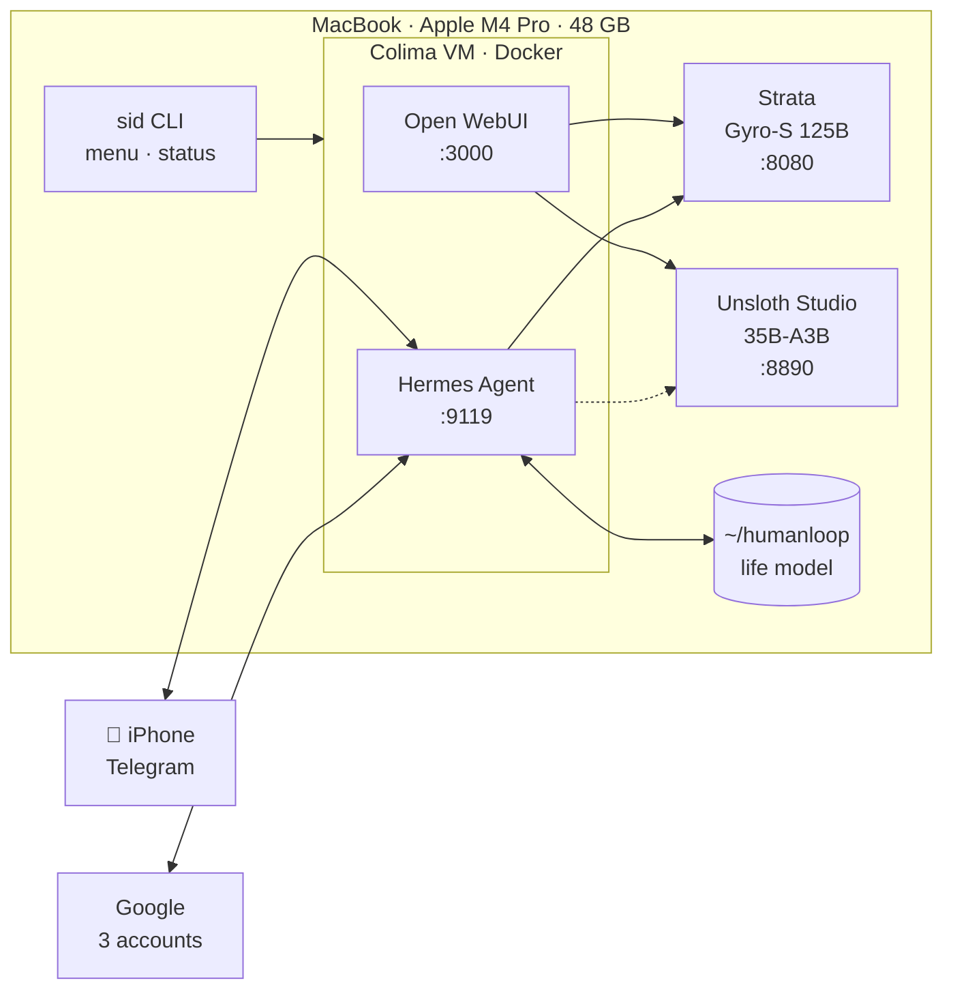

<div align="center">

# sid-local-ai

**A private AI stack that runs entirely on a MacBook, and HumanLoop, the personal agent built on it.**


[Architecture](docs/architecture.md) · [HumanLoop](docs/humanloop.md) · [Benchmarks](benchmarks/README.md) · [Setup log](docs/setup-log.md) · [TODO](TODO.md)

</div>

---

Local language models served natively on Apple Silicon, a chat UI and an autonomous agent in
Docker, and a hacker-style launcher. On top of that runs **HumanLoop**: an agent that learns your
goals, projects and routines, then checks in during the day on Telegram to help you do what you
meant to do. Every model call stays on the laptop.

## What's inside

| | Component | What it does | Where |
|---|---|---|---|
| 🧠 | **Strata** · Qwen3.8-Flash-Next Gyro-S (125B MoE) | Main model: the smartest that fits in 48 GB | native, `:8080` |
| ⚡ | **Unsloth Studio** · Qwen3.6-35B-A3B | Fast alternative: about 3x quicker prompts | native, `:8890` |
| 💬 | **Open WebUI** | Chat in the browser with either model | Docker, `:3000` |
| 🤖 | **Hermes Agent** | Agent with tools, skills, memory, cron and a Telegram gateway | Docker, `:9119` |
| 🔁 | **HumanLoop** | Life model + onboarding interview + check-ins, on the phone | Hermes skills |
| 🎓 | **Study coach** | Lecture Q&A with metaphors and visual cards, morning brief | Hermes skill |
| 🖥️ | **`sid` CLI** | Boot screen, menu and live status; opens with a double clap | native |
| 📊 | **llama-benchy** | Reproducible speed benchmarks | `benchmarks/` |

Also installed: uv, bun, `gws` (Google Workspace CLI, 3 profiles), `gh`, `hf`, `cf`, HyperFrames skills.

## How it fits together



Only one model server runs at a time (both do not fit in memory). `start-strata.sh` and
`start-unsloth.sh` each stop the other one and point Hermes at themselves.

## Speed on this Mac

Same test on every model: llama-benchy, 2,048-token prompt plus 128 generated tokens, thinking off,
Chrome closed. Full method and runs in [benchmarks/](benchmarks/README.md).

| | Qwen3.8-27B (dense) | **Qwen3.6-35B-A3B** (MoE, 3B active) | **Qwen3.8-Flash-Next Gyro-S** (125B MoE, Strata) |
|---|---|---|---|
| Reading the prompt, at 0 / 8K / 32K context | 118 / 113 / 57 t/s | **813 / 710 / 517** | 289 / 279 / 287 |
| Writing the answer | 19 / 20 / 8 t/s | **58 / 42 / 33** | 29 / 30 / 29 |
| Hermes, "capital of Nepal?", first / next question | 132 s / 9 s | **31 s / 4 s** | 58 s / **5-6 s** |
| Role | kept for comparison | fast alternative | **main model** (smartest) |

## Quick start

**Prerequisites:** macOS on Apple Silicon, Homebrew, Colima, uv. Every install step is in
[docs/setup-log.md](docs/setup-log.md).

```sh
git clone https://github.com/sidhantbas/sid-local-ai && cd sid-local-ai
cp .env.example .env                      # then fill in the values
./scripts/setup/install-cli.sh            # the sid command (+ double-clap listener)
sid                                       # boot screen and menu → 1 starts everything
```

### The `sid` menu

| Key | Action | | Key | Action |
|---|---|---|---|---|
| `1` | Start the stack (Colima → Open WebUI → Hermes → Strata) | | `6` | Check all 3 Google profiles |
| `2` | Talk to Hermes | | `7` | Shut down the stack |
| `3` | Open WebUI in the browser | | `8` | Hermes reads unread mail, all accounts |
| `4` | Hermes dashboard | | `9` | **HumanLoop**: life model and onboarding |
| `5` | Live status | | `q` | Exit to the shell |

Or run `sid launch` for the full-screen terminal, or double clap within 60 s of unlocking the Mac.
In VS Code, **Terminal → Run Task** offers the same actions (`.vscode/tasks.json`).

### Scripts

<details>
<summary><b>scripts/stack/</b>: start, stop and switch</summary>

```sh
./scripts/stack/start-strata.sh       # main model: Gyro-S on :8080 (stops Unsloth; close Chrome first)
./scripts/stack/start-unsloth.sh      # fast model: 35B-A3B on :8890 (stops Strata; add 27b for the 27B)
./scripts/stack/start-colima.sh       # Docker runtime (4 GB VM)
./scripts/stack/start-open-webui.sh   # http://localhost:3000
./scripts/stack/start-hermes.sh       # http://localhost:9119
./scripts/stack/status.sh             # what is running
./scripts/stack/stop-{hermes,open-webui,strata,unsloth,colima}.sh   # data is kept
```
</details>

<details>
<summary><b>scripts/setup/</b>: one-time installs and integrations</summary>

```sh
./scripts/setup/install-cli.sh             # sid CLI + clap listener (LaunchAgent)
./scripts/setup/install-keep-awake.sh      # no idle sleep while a model serves; lid close still sleeps
./scripts/setup/install-hermes-skills.sh   # copy hermes/skills/ into Hermes
./scripts/setup/humanloop-init.sh          # create the life model in ~/humanloop (never overwrites)
./scripts/setup/hermes-telegram.sh <id>    # Telegram bot that answers only you; token from the clipboard
./scripts/setup/hermes-study-brief.sh      # weekday 07:30 lecture brief on Telegram
```
</details>

<details>
<summary><b>scripts/bench/</b> and <b>scripts/google/</b></summary>

```sh
./scripts/bench/llama-benchy.sh --engine <label>    # benchmark the loaded Unsloth model
./scripts/bench/llama-benchy.sh --strata <label>    # benchmark Strata
./scripts/google/gws.sh <profile> gmail +triage     # gws as one Google account
./scripts/google/test-gws.sh                        # Gmail / Calendar / Tasks for every profile
```
</details>

## HumanLoop

> *Understand a life before trying to optimise it.*

HumanLoop builds a model of your **goals, projects, commitments, routines and preferences**,
then helps close the gap between what you intended and what happened. Hermes, on the local model,
is the orchestrator; HumanLoop proposes and you approve.

- **Life model you can read.** Plain Markdown in `~/humanloop/` (outside git), one fact per
  line, each tagged `[verified]` (from your calendar), `[declared]` (you said it) or `[inferred]`
  (only saved after you approve it).
- **Onboarding interview.** Six short sections; it also reads the next 14 days of all three calendars.
- **On the phone.** A Telegram bot that only answers you: quick capture, voice notes transcribed
  on the Mac, and messages sent while the Mac is off answered when it is back.
- **Study coach.** Ask about a lecture from your seat; get a short answer, a metaphor and the
  matching visual card.

Next: daily plan, hourly check-ins, evening reflection, then a private web app for the phone.
Details in [docs/humanloop.md](docs/humanloop.md); roadmap in [TODO.md](TODO.md) (W8).

## Repository layout

```
sid-local-ai/
├── README.md                you are here
├── AGENTS.md                rules for people and coding agents (CLAUDE.md links here)
├── TODO.md                  task ledger: workstreams, status, size, priority
├── .env.example             settings to copy into .env (git-ignored)
├── scripts/
│   ├── stack/               start / stop / status, model switch, keep-awake
│   ├── setup/               one-time installs: CLI, skills, Telegram, HumanLoop, study brief
│   ├── bench/               llama-benchy runner
│   └── google/              gws per-account wrapper and check
├── docker/
│   └── docker-compose.yml   Open WebUI + Hermes
├── hermes/
│   ├── Dockerfile           pinned Hermes image + local speech-to-text
│   └── skills/              humanloop, google-accounts, study-coach
├── cli/                     the sid CLI (Python, uv)
├── benchmarks/              results, one folder per run, with environment and logs
├── docs/
│   ├── architecture.md      every component, port, setting and why
│   ├── humanloop.md         HumanLoop design and channels
│   ├── mapreduction.md      splitting big tasks (video, design, products) across agents
│   └── setup-log.md         every command run on this machine, in order
└── .vscode/                 tasks, settings, recommended extensions
```

## Privacy and security

- **Model calls never leave the Mac.** Strata and Unsloth listen on `127.0.0.1` only;
  voice notes are transcribed locally with faster-whisper.
- **No secrets in git.** API keys and passwords live in `.env` (git-ignored); Google tokens in
  the macOS keychain (`gws`) and the Hermes data volume (mode 600); personal data in
  `~/humanloop` and `~/brain`, outside the repo.
- **The agent obeys only its owner.** The Telegram bot accepts one user id; Hermes denies
  everyone else. Sending mail or changing calendars needs an explicit yes.
- **Telegram is the exception:** phone messages pass through Telegram's servers. The planned
  web app keeps phone-to-Mac traffic private over Tailscale.

## Working on this repo

The full rules are in [AGENTS.md](AGENTS.md); the short version:

- **Track work in [TODO.md](TODO.md).** States `[ ]` `[.]` `[~]` `[x]` `[-]`, size `(XS)` to `(L)`,
  priority `P0` to `P2`. Items are never deleted, only marked done or superseded.
- **Record every command run on the machine** in [docs/setup-log.md](docs/setup-log.md), and
  every setting and the reason for it in [docs/architecture.md](docs/architecture.md).
- **Benchmark before changing the default model**, with `scripts/bench/llama-benchy.sh`.
  Close Chrome first, because swapping makes the numbers meaningless.
- **Pin versions** (images by digest, packages by version). Read downloaded install scripts
  before running them.
- **Commit authors are people.** AI-assisted commits carry a `Co-Authored-By` line.

## Credits

Built by **[Sidhant Bastola](https://github.com/sidhantbas)** under the mentorship of **Charles Cai**.

Made possible by [Strata](https://github.com/Niko1221/Strata), [Unsloth](https://github.com/unslothai/unsloth),
[llama.cpp](https://github.com/ggml-org/llama.cpp), [Hermes Agent](https://github.com/NousResearch/hermes-agent),
[Open WebUI](https://github.com/open-webui/open-webui), [Colima](https://github.com/abiosoft/colima),
[llama-benchy](https://pypi.org/project/llama-benchy/), [faster-whisper](https://github.com/SYSTRAN/faster-whisper)
and the [Qwen](https://github.com/QwenLM) models.
