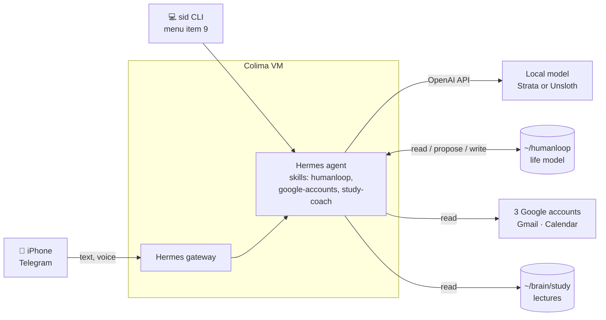

# HumanLoop

HumanLoop is a local-first personal intelligence agent: it first builds a model of Sid's
life (goals, projects, commitments, routines, preferences), then helps close the gap between
what Sid intends and what actually happens. **Hermes, running on the local model, is the
orchestrator**; this repo holds its skills, scripts and docs. Sid stays in charge: HumanLoop
proposes, Sid approves.

Roadmap and status: TODO.md, workstream W8.

## How it fits together

## Life model, desktop and phone (2026-10-24)

- Hermes, on the local model, is the orchestrator. The `humanloop` skill
  (`hermes/skills/humanloop/`, copied in by `scripts/setup/install-hermes-skills.sh`) holds the rules
  and the onboarding interview (`references/onboarding.md`).
- Life model: Markdown in `~/humanloop/` on the Mac (created by `scripts/setup/humanloop-init.sh`,
  mode 700, not in git), bind-mounted into Hermes at `/opt/data/humanloop`. Plain files, not
  SQLite, because SQLite on virtiofs can corrupt. `model/` holds goals, projects, commitments,
  routines, preferences and `proposed.md` (waiting for approval); `onboarding.md` tracks the
  interview; `decisions.md` logs decisions.
- One fact per line: `- [verified|declared|inferred] text · src: ... · id: x-001`. Verified
  facts come from connected sources (the three Google accounts via `gacct`), declared ones
  from Sid, inferred ones from Hermes and only with Sid's approval.
- `sid` menu item 9 opens an interactive Hermes chat with `humanloop` and `google-accounts`
  loaded and the terminal tool only.
- Phone (Sid's iPhone): a Telegram bot through Hermes's gateway, set up by
  `scripts/setup/hermes-telegram.sh`. The token lives in Hermes's `.env` in its volume (mode 600);
  `TELEGRAM_ALLOWED_USERS` holds only Sid's id (Hermes denies everyone else by default). A
  channel prompt for Sid's chat makes it HumanLoop; quick captures go to `inbox.md`.
  `drop_pending_on_cold_boot: false`: messages sent while the Mac is off (Telegram keeps them
  ~24 h) are answered when Hermes starts. Messages pass through Telegram's servers; the
  planned web app (TODO W8, mobile B) keeps phone ↔ Mac traffic private over Tailscale.
- Voice notes are transcribed in Hermes by faster-whisper (`stt.provider: local`, model
  `base`, cached in the volume via `HF_HOME=/opt/data/.cache/huggingface`): the audio never
  leaves the Mac. ~2 s for a short note.

## Study coach (2026-10-26)

- Lecture companion on the same Telegram chat. `~/brain/study` (Sid's brain repo) is bind-mounted
  into Hermes at `/opt/data/study`: per-lecture `brief.md`, `slides.txt`, visual cards
  (`cards/*.png`) and `questions.md`, plus `schedule.json` from the timetable export.
- The `study-coach` skill (`hermes/skills/study-coach/`) answers lecture questions in three steps:
  `coach.py context "<question>"` (brief, matching slide lines, card paths), `coach.py log` (appends
  to the lecture's `questions.md`), then a reply of at most 120 words: answer, how to think about
  it, metaphor, engineer's view, check question, and the matching card as a `MEDIA:` line. On the
  35B-A3B: 17-25 s per question once the prompt is cached.
- `gateway.media_delivery_allow_dirs: [/opt/data/study]` lets Hermes send the cards;
  `timezone: Europe/London` so cron times are UK time. The Telegram channel prompt routes study
  questions to the skill (set by `scripts/setup/hermes-telegram.sh`).
- Morning brief: `scripts/setup/hermes-study-brief.sh` adds the cron job `study-brief` (weekdays 07:30,
  `--no-agent`): it runs `study/tools/today.py` and delivers its text; silent on days without classes.
