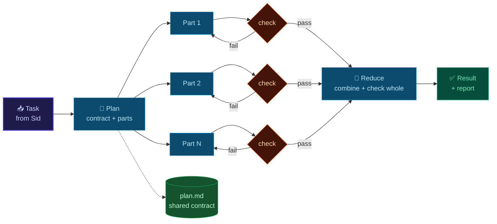

# Map-reduce for big agent tasks

A big task done by one agent in one long session is slow, and the agent loses track as its context fills up. Map-reduce splits
the task instead: **plan** a shared contract, **map** each independent part to its own agent with a short brief, **check** every
part on its own, then **reduce**, meaning one agent combines the parts and checks the whole.

- ⚡ **Faster:** the parts run at the same time (with Claude Code; see [Which agent](#which-agent)).
- 🧩 **Easier:** each agent holds only its part, so its brief is short and its mistakes stay small and local.
- ✅ **Safer:** a failed part is redone alone instead of restarting everything.

## The four steps

Each part gets the same contract, works only in its own folder, and must pass its check before the reduce step sees it:



| Step | Who | What it produces |
|---|---|---|
| 1. Plan | the main agent | `plan.md`: the goal, the contract every part must follow, the list of parts, and each part's done-check |
| 2. Map | one subagent per part | the part, written only into `parts/<NN-name>/` |
| 3. Check | the subagent, then the main agent | proof the part works on its own (a rendered frame, a screenshot, passing tests) |
| 4. Reduce | the main agent | the combined result in `final/`, checked as a whole, and a short report to Sid |

**The contract is what makes parallel parts fit together.** Without one, each part invents its own colours, sizes and names, and
the reduce step turns into a rewrite. Write it before mapping anything.

### When to use it

| Use map-reduce | Do it in one agent |
|---|---|
| 3 or more parts that do not need each other's output | a small task, or one a single agent finishes in minutes |
| each part can be checked on its own | steps that depend on each other in a chain |
| several distinct options are wanted (design directions, scripts) | many small edits to the same file |

## Which agent

| | Claude Code (coding agent) | Hermes (local agent) |
|---|---|---|
| Map runs | **in parallel**: one subagent per part | **one at a time** on Strata (`--parallel 1`); Unsloth has 4 slots sharing 64K tokens |
| Model | cloud | on this Mac |
| Tools for this | HyperFrames skills (video), artifact and design skills, Figma, tests | `delegation`, `image_gen` and `browser` tools, the `gacct` Google skill |
| Personal data (`~/humanloop`, `~/brain`, mail) | ❌ never | ✅ yes: this is what Hermes is for |
| Best for | videos, visual designs, products in code | summaries and plans over personal data that is too big for one 64K context |

🔑 **Privacy rule (AGENTS.md):** a task that touches personal data runs on Hermes only. Claude Code subagents get public or
made-up material.

⚠️ Hermes's `image_gen` tool may call an outside service; check where it sends prompts before using it with anything private.

## Folder layout

Every task gets its own folder under `work/` (git-ignored, so renders and assets never reach GitHub):

```text
work/2026-10-30-launch-video/
├── plan.md          the contract: goal, shared rules, parts, done-checks
├── parts/
│   ├── 01-intro/    one folder per part; its agent writes only here
│   ├── 02-problem/
│   └── 03-demo/
├── final/           written only by the reduce step
└── report.md        what was made, what was checked, what failed and was redone
```

## Writing a map brief

Each subagent starts cold, so its brief must stand alone. Point at files instead of explaining them:

```text
Task: <one sentence: this part only>
Contract: read work/<task>/plan.md first and follow it exactly (style, sizes, names).
Write only into: work/<task>/parts/<NN-name>/
Done when: <the check, e.g. "renders without errors; frame at 2 s saved as preview.png">
Do not: edit other parts, change the contract, use personal data.
Report: files made, the check result, anything the contract did not cover.
```

If a part needs something the contract does not cover, the subagent reports it, and the main agent updates `plan.md` for every
part rather than letting one part decide alone.

## Recipes

### 🎬 Video (HyperFrames)

1. **Plan:** a storyboard in `plan.md` with one row per scene (duration, narration, what is on screen), plus the contract:
   resolution and frame rate, the colour palette, fonts, the transition style, and the file each scene exports. Load the
   `hyperframes` skill first; it holds the render contract.
2. **Map:** one subagent per scene builds its composition in `parts/NN-scene/`, using `hyperframes-registry` blocks before
   hand-building anything, and `media-use` for music, icons, images or voiceover.
3. **Check:** each scene renders on its own; save a few still frames and look at them.
4. **Reduce:** assemble the scenes on one timeline, add transitions and the audio mix, render the full video, and check frames at
   each scene boundary.

Rendering is heavy. With Strata loaded (25–33 GB), render one scene at a time and run `./scripts/stack/status.sh` to watch memory.

### 🎨 Visual design

There are two shapes, depending on the request:

- **Options (best of N):** map the *same* brief to 3–4 subagents, each told to take a different direction (for example minimal,
  bold, playful). Reduce puts them side by side, Sid picks one, and the winning direction is refined.
- **Screens:** map one subagent per screen or component, all sharing the tokens in `plan.md` (palette, type scale, spacing,
  corner radius). Reduce puts the screens together and fixes whatever does not match.

Check each part with a screenshot at phone and desktop width, and check text contrast in light and dark mode.

### 🧱 Products (apps and features)

1. **Plan:** write the interfaces first: the API or function signatures, the data schema, and which files each part owns. **No
   two parts edit the same file.**
2. **Map:** one subagent per module. All of them work in this checkout, because AGENTS.md rules out worktrees unless Sid asks.
3. **Check:** each module's own tests, plus `bash -n` for scripts.
4. **Reduce:** integrate the modules, run the full checks (`status.sh`, `sid status`, the tests), and commit in batches, one commit
   per unit of work, when Sid asks.

### 🔒 Local, private data (Hermes)

Example: a weekly review across three Google accounts and the life model.

- **Map:** one delegated subtask per account ("summarise this week's mail and calendar for account X in 10 lines"), then one per
  life-model file.
- **Reduce:** one briefing that compares what was planned with what happened, given to Sid as a proposal (HumanLoop's rule).

On Strata the subtasks run one after another, so this is not faster. It still works better, because each subtask fits easily in
64K tokens and the final answer is built from short summaries, not raw mail.

## Speed tips

- **Pick 3–6 parts.** Each subagent starts cold and re-reads its files, so many tiny parts cost more than they save.
- **Plan before you map:** ten minutes on the contract saves an hour of fixing mismatched parts.
- **Check before you reduce:** a part that fails its check is redone alone, before the reduce step depends on it.
- **Reuse before you build:** registry blocks, existing components and design tokens beat new ones written in parallel by
  several agents.
- **Keep the report:** `report.md` records what was redone and why, so the next task's plan avoids it.
